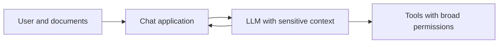
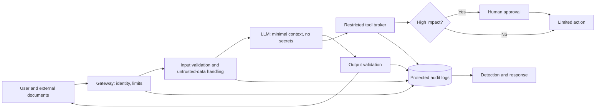

# Secure AI Architecture

## Naive design

## Improved design

## Design principles

- Do not put real secrets in model context.
- Authenticate users and authorise actions outside the model.
- Treat retrieved content and user documents as untrusted data.
- Use layered controls; keyword filters alone are insufficient.
- Restrict tools, data and network access by default.
- Require human approval for consequential actions.
- Protect logs and minimise collection of personal data.
